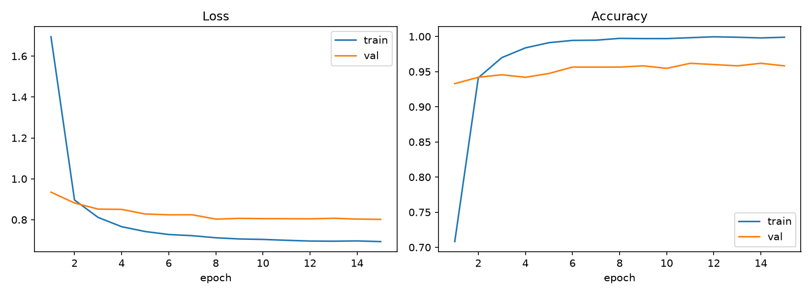
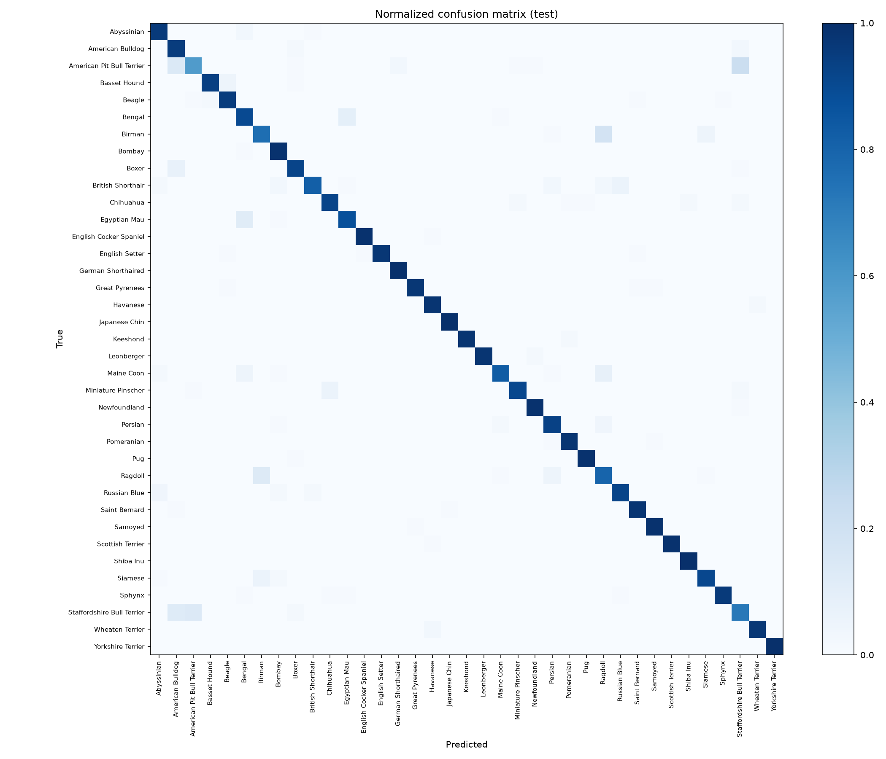
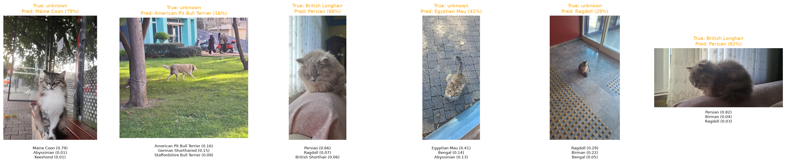

# Evcil Hayvan Irkı Sınıflandırıcı — Oxford-IIIT Pet üzerinde ResNet-50

Derin Öğrenme dersi ödevi: transfer learning (ImageNet ön eğitimli ResNet-50) ile 37 kedi ve köpek
ırkının ince taneli (fine-grained) sınıflandırması. Eğitilen model Gradio web uygulaması olarak sunulmuştur.

## Sonuçlar (resmi test bölümü, 3669 görüntü)

| Metrik | Değer |
|---|---|
| Accuracy | %92.75 |
| Top-5 accuracy | %99.37 |
| Precision (macro) | %92.91 |
| Recall (macro) | %92.71 |
| F1-score (macro) | %92.66 |
| En iyi validation accuracy | %96.20 (epoch 11) |
| Eğitim süresi | 14.5 dk (RTX 3060 Laptop, 6 GB) |
| Tahmin süresi (batch=1) | GPU 6.2 ms / CPU 113.5 ms |




En çok karıştırılan çiftler görsel olarak birbirine çok benzeyen ırklardır: American Pit Bull Terrier ↔
Staffordshire Bull Terrier, Birman ↔ Ragdoll.

## Gerçek fotoğraflarla test (telefonla çekilen fotoğraflar)



Tür (kedi/köpek) 6 fotoğrafın 6'sında doğru tahmin edildi. Sokak hayvanlarının ırkı doğrulanamadı. Gri kedi
British Longhair ırkındandır ve bu ırk 37 sınıf arasında yer almamaktadır; model en yakın akrabası olan
Persian'ı tahmin etmiştir.

## Kurulum

```bash
python -m venv venv
venv\Scripts\activate            # Linux/Mac: source venv/bin/activate
pip install torch torchvision --index-url https://download.pytorch.org/whl/cu126
pip install -r requirements.txt
```

Veri seti: [Oxford-IIIT Pet](https://www.robots.ox.ac.uk/~vgg/data/pets/). İlk çalıştırmada `data/` klasörüne
otomatik indirilir. İndirme yavaşsa `images.tar.gz` ve `annotations.tar.gz` dosyalarını elle indirip
`data/oxford-iiit-pet/` içine açabilirsiniz.

## Kullanım

```bash
python -m scripts.train          # train, saves best checkpoint
python -m scripts.evaluate       # test metrics, confusion matrix, latency
python -m scripts.predict_real   # predictions on real_photos/
python -m app.gradio_app         # web app at http://127.0.0.1:7860
```

## Proje yapısı

```
src/        yapılandırma, veri hattı, model, yardımcı fonksiyonlar
scripts/    eğitim / değerlendirme / gerçek fotoğraf tahmini
app/        Gradio uygulaması
outputs/    grafikler ve metrikler (checkpoint dosyaları gitignore'da)
```
